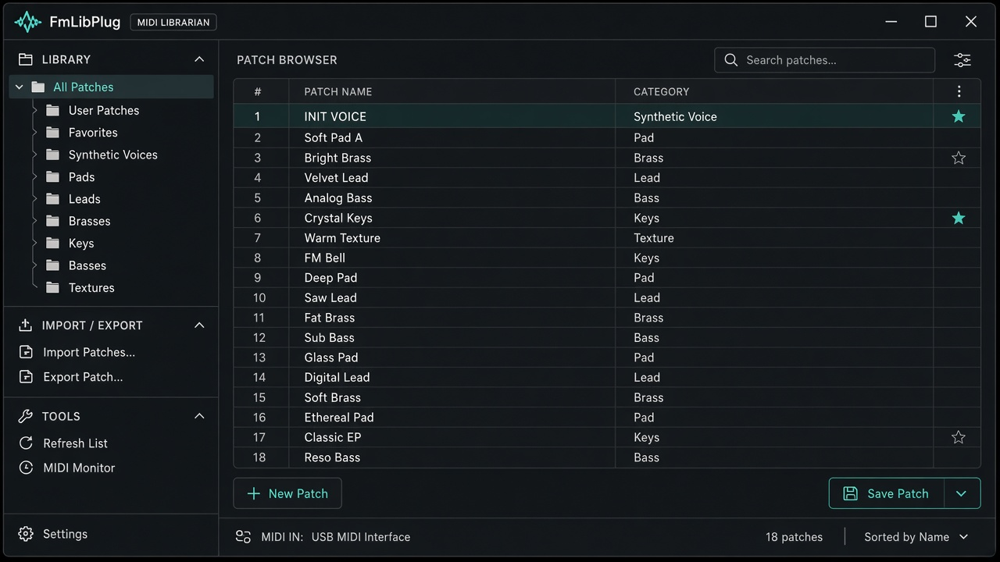
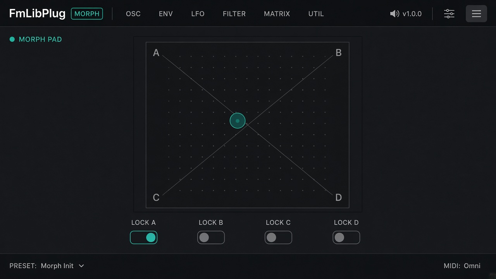
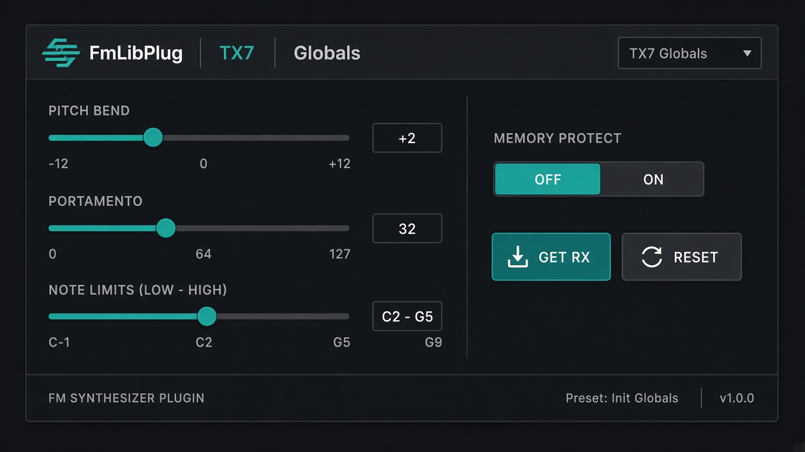
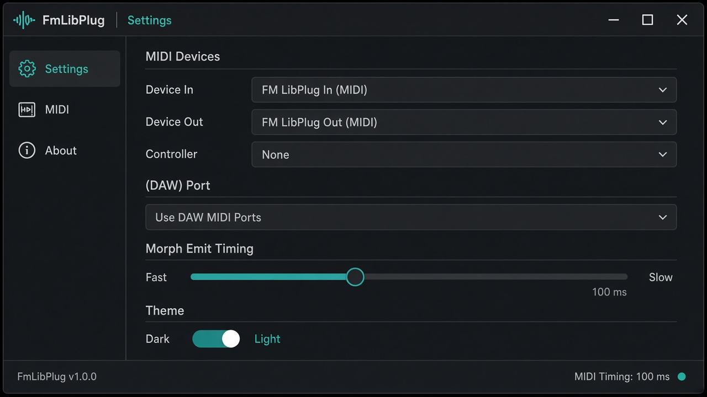

# FmLibPlug

**Version 1.3.7** — AGPL-3.0 JUCE 8 MIDI librarian for **DX7 / TX7–compatible** voice SysEx.

FmLibPlug browses multi-folder SysEx libraries, sends and receives DX7/TX7 voice and function data, and morphs four corner patches over MIDI — as a plugin (VST3/LV2/CLAP/AU) or Standalone. Audio is passthrough; the product is MIDI/SysEx I/O with a real-time-safe `(DAW)` host bus path.

Product name: **FmLibPlug**. Compatibility only: FM SysEx librarian for DX7 mkI / TX7 hardware and compatible devices. Release notes: [CHANGELOG.md](CHANGELOG.md). Version source: `project(FmLibPlug VERSION ...)` in `CMakeLists.txt`. Cross-platform notes: [docs/PLATFORM.md](docs/PLATFORM.md). Threading / RT: [docs/THREADING.md](docs/THREADING.md).

Yamaha, DX7, and TX7 are trademarks of Yamaha Corporation. FmLibPlug is an independent project and is **not affiliated with, endorsed by, or sponsored by Yamaha**. Provided **without warranty**; see [LICENSE](LICENSE).

Do **not** commit or redistribute third-party voice banks or cartridges. Keep local `.syx` / `.dx7` libraries in gitignored folders (e.g. `Presets/`). Test fixtures under `Tests/fixtures/` are synthetic. Screenshots below use synthetic voice names only.

## Screenshots

Illustrative UI mockups (synthetic patch names only — not live captures of a DAW session):

| Library browser | Morph pad |
|-----------------|-----------|
|  |  |

| TX7 Globals | Settings |
|-------------|----------|
|  |  |

Morph pad motion (illustrative SVG): 

## Features

- Multi-folder recursive `.syx` / `.dx7` library (case-insensitive), background scan; Settings can enable/disable each folder
- Voice names from SysEx + tooltips for file/path; optional file columns
- Bank / All views: Bank groups by bank file; All is a flat list of every voice. Filter **`:singles`** for 1-voice SysEx (format 0x00 / Dexed-compatible 128-byte, including concatenated singles). Hide duplicates treats the same sound in another bank/slot as a dupe (name is ignored). Left/Right prev/next bank or A–Z/digit group; load bank via double-click
- Hold **Audition** (or hold `A`) to play the configured audition note; release to stop
- Context **Audition** loads the row then plays the Settings **Audition duration** note
- Right-click selects (no SysEx); left-click loads. **Set morph corner** does not pause morph
- Load **1 voice** (edit buffer) or **32-voice bank** via direct MIDI out; audition note
- Get / receive dumps into a temporary device buffer; drag-drop bank edit; **Send** (1 voice or full 32-bank) / **Save...**
- **TX7 Globals** (under Device): Get/Reset Fn, resizable Voice-A sheet (play/PB/porta/controllers); Attenuator Apply (bulk); Protect Off; dirty-only apply-with-voice-load
- **Globals** page: note limits, MIDI/mode switches, Memory Protect (`g=4` live); Get RX / Reset to Yamaha defaults
- Favorites + search (`fav:` / `star:` / `tag:` / `dupe:` / `recent:` / `:singles` / AND/OR) + auto-tag (merge); click Tags to edit; Reset all tags in Settings
- XY morpher (4 corners + morph presets; parameter locks; edge LFO; Note morph via controller MIDI in)
- Morph while playing: frequency-only (default) or all-parameter streaming (see below)
- Dark / light theme, hardware checklist in Settings; resizable editor
- SysEx pacing; separate MIDI device vs controller inputs; **`(DAW)`** host MIDI bus option in Settings (plugin formats); audio **passthrough** insert

### Host integration (DAW)

Automatable parameters: **Morph X**, **Morph Y**, **Lock Ref X/Y**, **Edge LFO Rate**, **Edge LFO Sync**, **Edge LFO Div**, **Morph Motion** (Off / Random / Edges / Edge LFO). Saving the project recalls the last live morph set (corners, locks, pad). On the morph page, **Sync** locks Edge LFO to host tempo; **CCW** reverses the orbit. The selected division is one pad edge, so **1/4** is one full A-B-D-C orbit per bar of 4/4. Edge LFO keeps running while the transport is playing; Morph X/Y automation drives the pad when Edge LFO is off. In Settings, choose **`(DAW)`** on MIDI in/out/controller to route through the host instead of hardware ports (hidden in Standalone). Host MIDI into the **controller** port drives Note morph only; it is not sent to the synth unless **Forward controller MIDI to output** is on. Prefer hardware or Standalone for bulk SysEx if your DAW strips large messages on the plugin MIDI bus; avoid routing plugin MIDI out directly back into plugin MIDI in.

### Morph on DX7 mkI / TX7

Mid-note voice SysEx on an original DX7 / TX7 clicks or glitches, and that can be musical (think wavetable-style sweeps). Settings has three morph timing controls:

- **Morph while playing**
  - **Frequency only (smooth pitch)** — default. Oscillator coarse/fine/detune glide live; everything else waits for the next full dump once you stop playing.
  - **All parameters (full sweep)** — the whole voice sweeps in real time, clicks included.
- **Morph release hold (ms)** (default 250, 0–2000) — how long that saved-up dump waits after the last note-off, so it does not re-latch the patch during the release tail. Raise it for long envelopes; 0 sends immediately. A note morph, a direct pad click/drag, or a lock-reference release cancels the wait; the LFO and the automatic flush still respect it. Playing again before the hold ends restarts the timer from that release.
- **Note morph settle (ms)** (default 40, 0–100) — extra gap after the voice dump finishes on the wire before the delayed note-on. Wire time is measured automatically; raise this if note morphs still click on the attack.

Note morph jumps on the first key of a phrase and delays that note-on so the SysEx lands first. Factory locks keep **EG + Levels** at the **lock reference** (hollow marker; right-drag on the pad). Releasing Ref updates the current morph voice immediately, including while a note is held. Pad and Ref only move from clicks that start on the pad. Notes on the TX7's own keys need the controller input. **Reset defaults** restores morph, audition, UI options, SysEx pacing and controller thru (MIDI ports/channel, tags and library folders stay as they are).

## Requirements

- CMake ≥ 3.22
- C++17 compiler (Xcode Clang / MSVC / GCC)
- Git + network on first configure (FetchContent: JUCE 8.0.14, clap-juce-extensions @ `c1a5ad0`, Catch2 v3.5.4)

Plugin targets set `JUCE_WEB_BROWSER=0` and `JUCE_USE_CURL=0`. JACK stays off (`JUCE_JACK` defaults to 0 in JUCE 8). You do **not** need WebKit, CURL, JACK, LADSPA, or OpenGL packages to build FmLibPlug.

### Install dependencies

#### macOS

```bash
xcode-select --install          # Apple Clang + SDKs (once)
brew install cmake git          # Homebrew: https://brew.sh
```

Full Xcode.app is fine too; Command Line Tools alone usually suffice for CLI builds.

#### Linux

Minimal set for this project: toolchain + **ALSA** + **FreeType/Fontconfig** + **X11** (what `juce_audio_devices` / `juce_graphics` / `juce_gui_basics` need). Debian/Fedora use split `-dev`/`-devel` packages for headers; Arch packages usually include headers in the same package.

```bash
# Debian / Ubuntu
sudo apt update
sudo apt install -y build-essential cmake git pkg-config \
  libasound2-dev \
  libfreetype-dev libfontconfig1-dev \
  libx11-dev libxcomposite-dev libxcursor-dev libxext-dev \
  libxinerama-dev libxrandr-dev libxrender-dev
```

```bash
# Fedora
sudo dnf install -y gcc-c++ cmake git pkgconf-pkg-config \
  alsa-lib-devel \
  freetype-devel fontconfig-devel \
  libX11-devel libXcomposite-devel libXcursor-devel libXext-devel \
  libXinerama-devel libXrandr-devel libXrender-devel
```

```bash
# Arch
sudo pacman -S --needed base-devel cmake git pkgconf \
  alsa-lib freetype2 fontconfig \
  libx11 libxcomposite libxcursor libxext libxinerama libxrandr libxrender
```

If `libfreetype-dev` is missing, try `libfreetype6-dev`. Full optional JUCE module list (WebKit, JACK, CURL, …): [JUCE Linux Dependencies](https://github.com/juce-framework/JUCE/blob/8.0.14/docs/Linux%20Dependencies.md) — only needed if you enable those features.

#### Windows

1. Install [Git for Windows](https://git-scm.com/download/win).
2. Install [CMake](https://cmake.org/download/) (≥ 3.22) and enable “Add CMake to the system PATH”.
3. Install [Visual Studio 2022](https://visualstudio.microsoft.com/) (Community is fine) with the **Desktop development with C++** workload, or VS Build Tools with the same MSVC + Windows SDK components.
4. Optional: [Ninja](https://ninja-build.org/) for faster builds (`winget install Ninja-build.Ninja`).

Open **x64 Native Tools Command Prompt for VS 2022** (or a PowerShell where `cmake` and the MSVC toolset are on `PATH`), then use the Windows build steps below. Git Bash + `make` also works if you prefer the Unix flow.

Cross-platform notes and host-install checklist: [docs/PLATFORM.md](docs/PLATFORM.md).

## Build

### macOS / Linux (Make)

```bash
make configure-release   # or: make configure  (Debug)
make build               # Standalone + VST3 + LV2 + CLAP (+ AU on macOS) + tests
make install             # OS-default plugin folders (see below)
make plugins             # build && install
```

Artefacts:

```text
build/FmLibPlug_artefacts/Debug/   # or Release/
  Standalone/...
  VST3/FmLibPlug.vst3
  AU/FmLibPlug.component           # macOS only
  LV2/FmLibPlug.lv2
  CLAP/FmLibPlug.clap
```

Run Standalone from the build tree (not installed by `make install`):

```bash
# macOS
open build/FmLibPlug_artefacts/Release/Standalone/FmLibPlug.app

# Linux
./build/FmLibPlug_artefacts/Release/Standalone/FmLibPlug
```

Default install destinations (`make install`):

| OS | VST3 | CLAP | LV2 | AU |
|----|------|------|-----|----|
| macOS | `~/Library/Audio/Plug-Ins/VST3` | `…/CLAP` | `…/LV2` | `…/Components` |
| Linux | `~/.vst3` | `~/.clap` | `~/.lv2` | — |

Override with `VST3_DIR` / `CLAP_DIR` / `LV2_DIR` / `AU_DIR`. Quit the DAW fully after install; the UI shows version + build-id.

- `make shared` — shared code library only (not host-loadable)
- AUv3: `-DFMLIBPLUG_BUILD_AUV3=ON` (macOS; often unavailable on CLI toolchains)
- Optional: `-DFMLIBPLUG_COPY_PLUGIN_AFTER_BUILD=ON`

### Windows

Prefer **Ninja** (single-config; `CMAKE_BUILD_TYPE` applies):

```powershell
cmake -S . -B build -G Ninja -DCMAKE_BUILD_TYPE=Release `
  -DFMLIBPLUG_BUILD_TESTS=ON -DFMLIBPLUG_BUILD_CLAP=ON
cmake --build build -j
powershell -ExecutionPolicy Bypass -File scripts\install-plugins.ps1 -Config Release
```

Or **Visual Studio 2022** (multi-config; omit `CMAKE_BUILD_TYPE`, always pass `--config`):

```powershell
cmake -S . -B build -G "Visual Studio 17 2022" -A x64 `
  -DFMLIBPLUG_BUILD_TESTS=ON -DFMLIBPLUG_BUILD_CLAP=ON
cmake --build build --config Release -j
powershell -ExecutionPolicy Bypass -File scripts\install-plugins.ps1 -Config Release
```

Run Standalone (Release artefacts; use `Debug` if you configured Debug / built `--config Debug`):

```powershell
.\build\FmLibPlug_artefacts\Release\Standalone\FmLibPlug.exe
```

Defaults: `%CommonProgramFiles%\VST3`, `%CommonProgramFiles%\CLAP`, `%APPDATA%\LV2`. AU is Apple-only.

**Status:** GitHub Actions verifies configure + Release build + unit tests on **macOS** and **Ubuntu**. Windows build/install and Linux/Windows **plugin install into hosts** are still checklist-only — see [docs/PLATFORM.md](docs/PLATFORM.md).

## Tests

Requires `FMLIBPLUG_BUILD_TESTS=ON` (default). Targets match CMake.

For a first green build, `make check` (unit tests only) is enough — fixtures under `Tests/fixtures/` ship in-tree. Smoke and hardware tests are optional.

```bash
make check          # ctest -L unit (no MIDI, no local Presets/)
make check-smoke    # ctest -L smoke (needs local Presets/; gitignored)
make check-all      # unit + smoke
```

Or: `cmake --build build --target check` (also `check-smoke`, `check-all`).

### Real-time safety

`(DAW)` host MIDI uses lock-free rings so the audio thread does not allocate, lock, or `callAsync`. See [docs/THREADING.md](docs/THREADING.md).

```bash
./build/FmLibPlugUnitTests "[rt]"     # alloc-guard + ordering
./build/FmLibPlugUnitTests "[midi]"   # host routing + rings
```

Optional ThreadSanitizer build: `-DFMLIBPLUG_TSAN=ON` (also run as a non-blocking CI job on Linux).

### Hardware MIDI (TX7 / DX7)

Works on macOS, Windows, and Linux via the same CMake targets (`check-hw` / `check-hw-list`).

```bash
make check-hw-list   # list MIDI ports
cp Tests/hw-midi.local.json.example Tests/hw-midi.local.json
# set midiIn / midiOut from the list; "enabled": true
make check-hw
```

Config: `Tests/hw-midi.local.json` (gitignored), or `--config` / `FMLIBPLUG_HW_CONFIG`. Env overrides when set: `FMLIBPLUG_HW_MIDI`, `FMLIBPLUG_MIDI_IN` / `_OUT` / `_CH` / `_PACING_MS`, `FMLIBPLUG_HW_ALLOW_BANK_WRITE`.

- Prefer Standalone; free MIDI ports
- Computer Out → synth In; synth Out → computer In
- Channel matches local config (default 1)
- Bank overwrite: Memory Protect OFF + `allowBankWrite` / `FMLIBPLUG_HW_ALLOW_BANK_WRITE=1`
- Default suite: 1-voice dump, 32-voice dump, edit-buffer round-trip (no bank overwrite)
- Increase SysEx pacing if USB-MIDI drops data (`FMLIBPLUG_MIDI_PACING_MS` or Settings)
- Return toggles favorite; Left/Right prev/next bank or A–Z group (when the library list has focus); hold `A` for Audition; Space unbound (DAW transport)

## Contributing

See [CONTRIBUTING.md](CONTRIBUTING.md). Security reports: [SECURITY.md](SECURITY.md).

## License

Copyright (C) 2026 mywonderland808.

GNU Affero General Public License v3.0 — see [LICENSE](LICENSE).

If you distribute binaries (for example GitHub Releases), AGPL requires that you also offer the corresponding source for that build (this repository at the matching tag or commit), including AGPL-licensed JUCE as obtained via FetchContent.

### Third-party software and trademarks

| Component | Role | License / note |
|-----------|------|----------------|
| [JUCE](https://juce.com/) 8.0.14 | Audio plugin framework | AGPLv3 (FetchContent) |
| [clap-juce-extensions](https://github.com/free-audio/clap-juce-extensions) | CLAP wrapper | MIT (pinned commit `c1a5ad0`) |
| [Catch2](https://github.com/catchorg/Catch2) v3.5.4 | Unit tests | BSL-1.0 |
| [CLAP](https://cleveraudio.org/) | Plugin API (via clap-juce-extensions) | MIT-style |

VST is a trademark of Steinberg Media Technologies GmbH. FmLibPlug uses the VST3 SDK as provided by JUCE and is not affiliated with Steinberg.

Dexed is an independent open-source DX7-compatible synthesizer; FmLibPlug may read Dexed-style packed `.dx7` / 128-byte voice data for interoperability and is not affiliated with the Dexed project.

Yamaha, DX7, and TX7 are trademarks of Yamaha Corporation (see disclaimer above).
